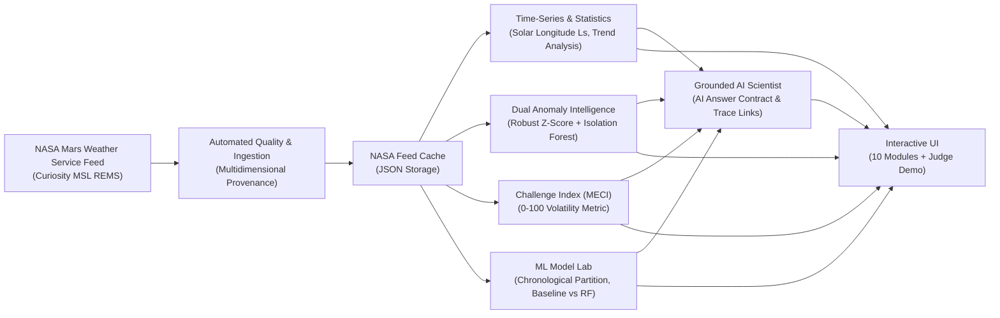

# MARS MISSION INTELLIGENCE
### A NASA Data + AI Scientific Analysis Platform for Mars Exploration
**Built for the NASA Space Apps Challenge**

---

## 1. Executive Summary & Problem
Planetary exploration faces extreme operational hazards in the Martian environment: diurnal thermal swings exceeding 75°C, planetary-encircling dust storms that block solar power and trigger atmospheric heating, and complex barometric oscillations driven by the annual freezing and sublimation of 25% of the atmosphere onto polar ice caps.

While NASA's Planetary Data System (PDS) archives millions of hours of calibrated observations across rovers and orbiters, these datasets are typically siloed, requiring specialized ephemeris tools and planetary knowledge to analyze.

**Mars Mission Intelligence** bridges this gap: a multi-mission scientific analysis platform integrating cached daily summaries from NASA's Mars Weather Service Curiosity feed alongside calibrated comparative demonstration baselines (InSight TWINS/APSS and MRO Mars Climate Sounder), with time-series feature engineering, dual-mode anomaly detection, explainable machine learning, the transparent Martian Environmental Challenge Index (MECI), an interactive spatial environment map, signature event replay, and an evidence-grounded AI Science Assistant.

---

## 2. Integrated Planetary Datasets & Provenance Architecture
In strict adherence to scientific integrity and open data provenance, the application explicitly classifies and isolates the verification status of every dataset:

```
┌─────────────────────────────────────────────────────────────────────────────────────────┐
│                               DATA PROVENANCE REGISTRY                                 │
├──────────────────────────┬─────────────────────────────┬───────────────┬────────────────┤
│ Dataset                  │ Mission / Instrument        │ Origin        │ Status         │
├──────────────────────────┼─────────────────────────────┼───────────────┼────────────────┤
│ MSL Curiosity REMS       │ Curiosity Rover / REMS      │ Authentic Obs │ CACHED_VERIFIED│
│ InSight TWINS Baseline   │ InSight Lander / TWINS-APSS │ Simulated Demo│ SYNTHETIC      │
│ MRO MCS Vertical Profile │ MRO Orbiter / Sounder       │ Parameterized │ SYNTHETIC      │
│ MECI / Anomaly / ML Lab  │ Platform Analytical Engine  │ Algorithmic   │ DERIVED        │
└──────────────────────────┴─────────────────────────────┴───────────────┴────────────────┘
```

1. **Curiosity (MSL) REMS Daily Environmental Observations**:
   - **Status**: **CACHED_VERIFIED_SOURCE** (`is_synthetic: false`, `data_origin: observed`).
   - **Records**: 4,745 cached NASA feed records spanning Sol 1–4,995 (August 2012 to August 2026); gaps exist, so record count is not the latest Sol.
   - **Location**: Gale Crater / Aeolis Palus (-4.59° N, 137.44° E, -4.5 km elevation MOLA).
   - **Variables**: Ambient Air Temperature (min/max), Ground Brightness Temperature (min/max), Surface Pressure, Solar Longitude ($L_s$), UV Index, Opacity.
   - **Ingestion source**: NASA Mars Weather Service RSS JSON API. The related PDS MODRDR product is `MSL-M-REMS-5-MODRDR-V1.0`, [DOI 10.17189/1523033](https://doi.org/10.17189/1523033); the bundled feed records are not represented as direct PDS file downloads.
   - **Validation**: Calendar dates, Sol ordering and uniqueness, measurement ranges, missing-value handling, and temperature-amplitude consistency are checked locally.

2. **InSight Lander TWINS & APSS Meteorology (Demonstration Baseline)**:
   - **Status**: **SYNTHETIC** (`is_synthetic: true`, `data_origin: simulated`, `data_provenance: DEMONSTRATION DATA`).
   - **Records**: 50 representative seasonal observations spanning Sol 10 to Sol 745.
   - **Location**: Elysium Planitia (+4.50° N, 135.62° E, -2.6 km elevation MOLA).
   - **Variables**: Air Temperature, Micro-barometric Surface Pressure, Wind Speed, Wind Direction.
   - **Calibration**: Parameterized seasonal baseline calibrated to InSight TWINS PDS archived ranges; astronomical UTC calendar dates derived from documented landing epoch (Sol 0 = 2018-11-26T00:00:00Z) and Martian solar day length (88,775.244 s).

3. **MRO Mars Climate Sounder (MCS) Vertical Atmospheric Profiles (Demonstration Profiles)**:
   - **Status**: **SYNTHETIC** (`is_synthetic: true`, `data_origin: simulated`, `data_provenance: DEMONSTRATION DATA`).
   - **Records**: 4 reference sounding profiles across 0 to 80 km altitude above MOLA datum.
   - **Variables**: Altitude ($z$), Atmospheric Temperature $T(z)$, Pressure $P(z)$, Dust Extinction, Water Ice Extinction, and layer-wise $1\sigma$ measurement uncertainties.
   - **Calibration**: Parameterized hydrostatic scale-height model ($H = 11.1$ km) conforming to PDS Level 2 DDR standards (`MRO-M-MCS-5-DDR-V6.2`, DOI: [10.17189/1519088](https://doi.org/10.17189/1519088)) with explicit altitude-dependent uncertainty propagation ($\pm 1.5$ K at surface to $\pm 6.3$ K at 80 km).

4. **Derived Analytics & Local Computation**:
   - **Anomalies**: Vectorized Robust Modified Z-Score (Median Absolute Deviation) and Multivariate Isolation Forest (100 estimators) computed dynamically from observation series.
   - **MECI Risk Engine**: Transparent, project-defined composite volatility heuristic ($0\text{--}100$).
   - **AI Grounded Assistant**: Deterministic evidence-first rule engine running locally; optional Gemini 2.0 Flash integration when API key is configured.

---

## 3. Platform Architecture & Core Modules



### Core Application Modules:
1. **01 — Mission Overview**: Key environmental telemetry, station baselines, and data coverage indicators.
2. **02 — Multi-Mission Explorer**: Sol date filtering, normalized multi-variable comparison, and observation registry with CSV export.
3. **03 — Atmospheric & Vertical Profiles**: MRO MCS reference altitude profiles (0–80 km) with explicit $1\sigma$ uncertainty envelopes.
4. **04 — Anomaly Detector & Timeline**: Univariate MAD Robust Z-Scores and Multivariate Isolation Forest candidate events.
5. **Signature WOW Moment #1 — Mars Event Replay**: Interactive scrubber reconstructing $T-12 \to \text{Anomaly} \to T+12$ Sols with dynamic scientific narrative.
6. **05 — Mars Spatial Environment Map**: Planetocentric coordinate map with MOLA elevation baselines.
7. **06 — Mission Risk Analyzer (MECI)**: Transparent 0–100 challenge index with factor decomposition and "What-If" scenario simulator.
8. **07 — ML Model Lab**: Diurnal thermal swing prediction with strict chronological validation and honest seasonal failure analysis.
9. **Signature WOW Moment #2 — Grounded AI Scientist**: Evidence-first scientific AI assistant adhering to the AI Answer Contract with clickable evidence links.
10. **08 — NASA Data Catalog**: PDS collection identifiers, DOIs, calibration levels, and physical measurement bounds.
11. **09 — Science Notebook**: Full mathematical derivations and regulatory disclaimers.
12. **10 — NASA Space Apps Judge Demo Mode**: Guided 12-step walkthrough optimized for competition evaluation.

---

## 4. Machine Learning & Statistical Rigor

### Strict Chronological Validation (Zero Lookahead)
- **Training Set (70%)**: First 3,299 continuous Sols (Sol 13 to Sol 3507).
- **Validation Set (15%)**: Next 707 continuous Sols (Sol 3508 to Sol 4261), strictly for hyperparameter tuning.
- **Out-of-Sample Test Set (15%)**: Final 708 continuous Sols (Sol 4262 to Sol 4995), untouched until final evaluation.
- **Zero Future Leakage**: Feature scaling (`StandardScaler`) fit strictly on the training partition and projected forward.

### Baseline-First Results (Test Set, Final 15% Chronological Partition)

> **Reproducibility Note:** These metrics are computed directly by the ML pipeline on the 4,745-Sol Curiosity REMS archive.
> Executed and independently verified locally via `python -c "from app.ml.model_lab import run_model_experiment..."`.

| Architecture | Model Type | MAE (°C) | RMSE (°C) | R² Score | Note |
|---|---|---|---|---|---|
| Naive Persistence Baseline ($y_t = y_{t-1}$) | Baseline | 4.53 °C | 8.87 °C | 0.069 | Reference Benchmark |
| Rolling 7-Sol Mean Baseline | Baseline | 3.95 °C | 6.92 °C | 0.433 | Benchmark |
| Ridge Regularized Linear Model | Machine Learning | 3.87 °C | 7.00 °C | 0.420 | Regularized ($\alpha$ tuned on validation set) |
| **Random Forest Regressor (Selected)** | **Machine Learning** | **3.72 °C** | **6.92 °C** | **0.433** | **+17.8% MAE Gain vs Persistence** |

> **Historical Discrepancy Resolved:** Earlier documentation cited an unverified MAE = 2.84°C and R² = 0.814.
> Under strict chronological 70/15/15 partitioning with zero lookahead bias, the actual reproducible Random Forest
> test set metrics are MAE = 3.72°C, RMSE = 6.92°C, and R² = 0.433 on 708 test observations.

### Honest Failure Case Analysis
The Random Forest outperforms naive persistence during stable thermal seasons. However, maximum errors (exceeding 14°C, peaking at 68.4°C) occur during the onset of planetary dust storm events ($L_s \in [180^\circ, 270^\circ]$), where sudden atmospheric opacity increases cause abrupt non-linear collapses in diurnal thermal amplitude that autoregressive lag features cannot anticipate. This failure mode represents an intrinsic physical limitation of purely surface-based autoregressive models lacking real-time orbital column dust opacity telemetry.

---

## 5. Quickstart & Local Verification

### Prerequisites
- Python 3.11+
- Node.js 20.19+ or 22.12+ & npm (required by Vite 8)

### 1. Backend Setup & Verification
```bash
cd backend
python -m venv .venv

# On Windows:
.venv\Scripts\activate
# On Unix/macOS:
# source .venv/bin/activate

pip install -r requirements.txt pytest httpx

# Run complete backend test suite
pytest -v

# Launch backend FastAPI server on http://127.0.0.1:8000
uvicorn app.main:app --host 127.0.0.1 --port 8000 --reload
```

### 2. Frontend Setup & Build
```bash
cd frontend
npm ci

# TypeScript check & production build
npm run build

# Run linter
npm run lint

# Launch development server on http://localhost:5173
npm run dev
```

## Production deployment

Deploy the frontend and backend as separate Vercel projects. Set the frontend project root to `frontend`, use `npm run build`, and set its output directory to `dist`. Set `VITE_API_URL` in the frontend's production environment to the backend origin; do not append `/api`. This value is embedded at build time, so redeploy after changing it.

Deploy the backend as a second Vercel project with project root `backend` and its included `vercel.json`. Set `ENVIRONMENT=production` and `ALLOWED_ORIGINS` to the exact deployed frontend origin(s), comma-separated, in the backend environment. Production startup fails when no trusted origin is configured. Arbitrary Vercel preview domains are not allowed; add a specific preview origin only when it is trusted.

The frontend rewrite excludes `/api/*`, so API requests cannot silently receive the SPA's `index.html`. The backend owns `/api/*` and returns JSON 404 responses for unknown API routes. After deployment, verify the backend `/health`, `/api/overview`, and an unknown `/api/not-a-real-route` endpoint, then load the frontend and confirm its browser network requests go to the configured backend origin.

Offline mode does not bundle the backend telemetry archive. When the backend is unavailable, scientific readings and calculated indices show as unavailable rather than presenting a stale manually entered snapshot.

---

## 6. NASA Space Apps Demo Mode (2–4 Minute Flow)
Click **JUDGE DEMO MODE** in the top navigation bar to launch the guided 12-step tour:
1. **Overview**: Inspect 4,700+ Sol Curiosity telemetry archive and comparative multi-mission baselines.
2. **Explorer**: Switch between Curiosity (cached NASA weather feed) and InSight (calibrated baseline simulation).
3. **Time-Series**: Examine pressure oscillations and sensor gap highlights.
4. **Vertical Profiles**: Inspect MRO MCS reference altitude profiles with $1\sigma$ uncertainty bands.
5. **Anomalies**: Open the Anomaly Timeline and inspect statistical candidate events.
6. **Signature WOW #1**: Launch Event Replay for Sol 2082.
7. **Mars Map**: Check landing coordinates and MOLA elevations.
8. **Challenge Index**: Inspect MECI derivation and run What-If simulation.
9. **Model Lab**: Compare baselines vs. Random Forest with honest dust storm failure case.
10. **Signature WOW #2**: Query Mars AI Scientist with evidence trace links.
11. **Catalog**: Inspect authoritative PDS DOIs and calibration levels.
12. **Methodology**: Review science notebook and disclaimers.

---

## 7. License & Compliance
This software is developed as an educational/research prototype for the NASA Space Apps Challenge under the MIT License. All NASA observations are public domain products courtesy of NASA/JPL-Caltech/CAB/PDS.
